# COMPASS demo history

Inventory of every distinct demo, builder, studio, office, and playground found in this repository, including remote branches. No tags exist. Screenshots were taken on 2026-11-11 from local boots with no model keys. Desktop frames are 1440×900. Mobile frames are 390×844.

The experience that matches “you dictate by voice and it builds, with the build visible” is the site builder last served at `c5cb564`. It is restored as `/demo` on this branch. The later intent → questions → plan preview stays at `/plan`.

## Which one, and why

`c5cb564` (merge of PR #6, 2026-11-03, author identity “AI”; the change itself is `4dd7724` by axmatea) is the last commit on `main` that served a public `/demo`. Both `/demo` and `/voice-demo` mapped to `compass/live.html`, which mounted `compass/src/site-demo/SiteDemo.tsx`.

That page is the only one that does all of the following:

- The visitor speaks or types a website, and can interrupt a run.
- A brief updates field by field, including a change of mind mid-build.
- A build log shows understanding, writing copy, invalidation, and a rendered version.
- A same-session HTML preview is drawn in an iframe. Nothing is published.
- The homepage call to action was “Talk to COMPASS”.

Prepared lines in that component are the ones a presenter would say: a premium dark AI-company site, then a warmer hero and a pricing section, then a lighter page with testimonials.

It is not the November plan preview (PR #11 and PR #12). That flow asks one to three questions and draws a web card plus a phone frame. It does not render a page or show a build log. Booting `c5cb564` with no key confirms the gap this branch closes: the old API returns 503 `not_configured`, and the page says it could not interpret the request. The preview stays empty. See `hist-sitedemo-desktop-nokey.png`.

## What was booted

`c5cb564` was checked out in a worktree, `npm ci` and `vite build` were run, and `node server.mjs` was started with no database and no model keys. These routes returned 200 and were screenshotted: `/`, `/demo`, `/voice-demo`, `/studio`, `/protect`, `/horizon`, `/vision`, `/presentation`, `/app`, `/acquisition`, `/login`, `/office`, `/demo.html`.

The current `main` plan preview was booted from this branch at `/plan`.

The September Next.js app called Longview (`2fab975`, root `package.json` name `longview`) was not booted. It is a separate Next 16 application with `@neondatabase/serverless`, from before `compass/` was the site. It is a simulated campaign clock, not the voice site builder.

The REMaster Python tree was not booted. Its public face at this commit is the scripted `/studio` page, which was booted.

## Inventory

### 1. Site builder — restored as `/demo`

| | |
| --- | --- |
| Commit | `c5cb564` (2026-11-03), files from `4f498d7` (2026-09-25, NAYL) onward |
| Route | `/demo` and `/voice-demo` → `compass/live.html` → `src/site-demo/SiteDemo.tsx` |
| What it does | Voice or text. Brief, build log, iframe preview. In-memory session. Mid-run changes invalidate only the copy that no longer fits. |
| Backend | Server LLM for the brief and for `write_copy`. Browser speech when Gradium and Boson were unset. No Postgres. |
| Env names | `LLM_PROVIDER`, `GENERAL_COMPUTE_API_KEY`, `GENERAL_COMPUTE_MODEL`, `GENERAL_COMPUTE_BASE_URL`, `GENERALCOMPUTE_API_KEY`, `GENERALCOMPUTE_MODEL`, `GENERALCOMPUTE_BASE_URL`, `GENERALCOMPUTE_TIMEOUT_MS`, `NEBIUS_API_KEY`, `NEBIUS_BASE_URL`, `NEBIUS_MODEL`, `NEBIUS_THINKING`, `NEBIUS_TIMEOUT_MS`, `VOICE_PROVIDER`, `GRADIUM_API_KEY`, `GRADIUM_BASE_URL`, `GRADIUM_VOICE_ID`, `GRADIUM_VOICE_NAME`, `GRADIUM_STT_LANGUAGE`, `BOSON_API_KEY`, `BOSON_VOICE`, `BOSON_TURN_DETECTION`, `BOSON_REALTIME_URL` |
| This boot | UI runs. With no key the turn returns 503 and the page does not build. |

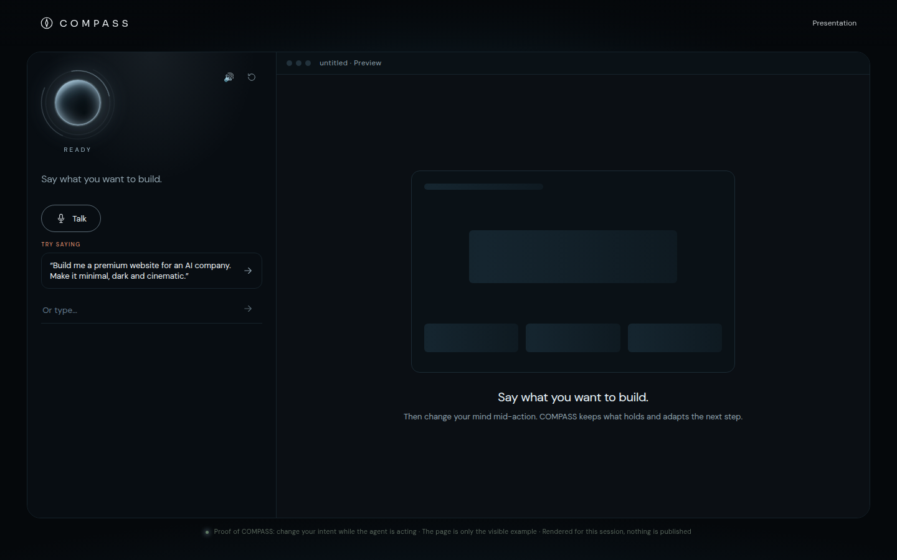

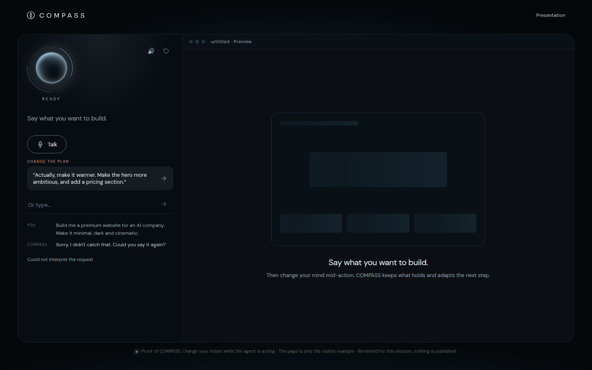

Mobile: `hist-sitedemo-mobile.png`, `hist-sitedemo-mobile-nokey.png`.

### 2. Plan preview — kept at `/plan`

| | |
| --- | --- |
| Commit | `d303bc2` (PR #11, 2026-11-10) and `fa2917d` (PR #12, voice, 2026-11-10) |
| Route | Was `/demo`. Now `/plan`. |
| What it does | Type or browser-dictate an intent, answer 1–3 questions, see a plan, a web card, and a phone frame. Prepared examples work with no key. No page render and no build log. |
| Backend | `compass/demo-api.mjs`. General Compute, then Nebius. |
| This boot | Works with no key. The barbershop example reaches a preview. |

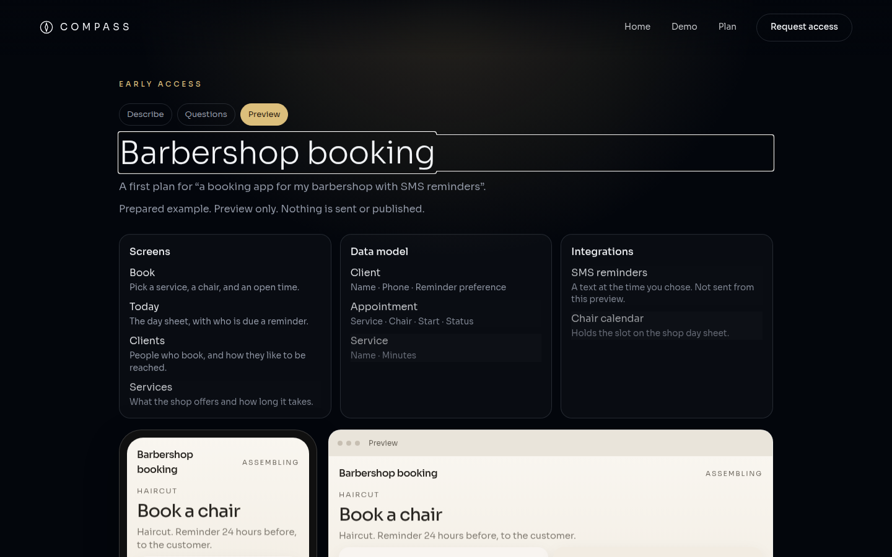

Also: `plan-preview-desktop-intent.png`, `plan-preview-desktop-questions.png`, and the `plan-preview-mobile-*.png` set.

### 3. “Think out loud” film page

| | |
| --- | --- |
| Commit | `4f498d7` (2026-09-25, NAYL), still present at `c5cb564` |
| Route | `/demo.html` only. The server did not map `/demo` here. About 2.6 MB, self-contained. |
| What it does | Cinematic landing, “Think out loud. Find what’s next.” Scripted concept. Not a builder. Its old credit line named Vincent. That credit is not on the restored site. |
| Backend | None for the page itself. |
| This boot | 200. Screenshot below. |

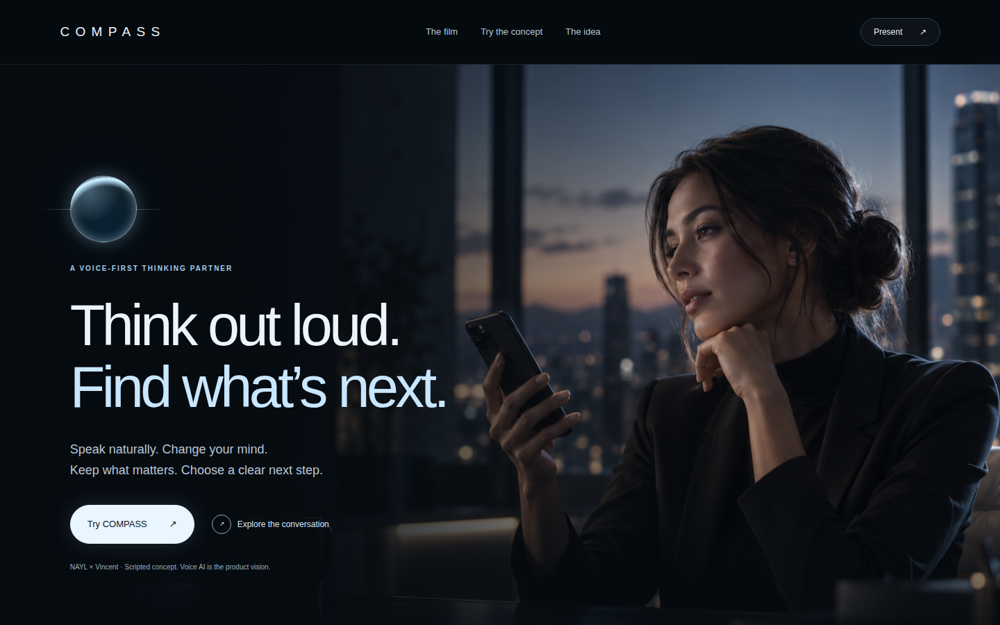

Mobile: `hist-think-aloud-mobile.png`.

### 4. Dinner voice agent

| | |
| --- | --- |
| Commit | `4f498d7` (2026-09-25, NAYL). `compass/src/components/CompassDemo.tsx`, originally mounted from `live.html`. |
| Route | By `c5cb564`, `live.html` mounted the site builder instead. The dinner runtime remained at `POST /api/turn`. |
| What it does | Voice planning for a dinner: time, place, cuisine, party size, then a restaurant search. Not a website build. |
| Backend | Same LLM chain. OpenStreetMap search, or `COMPASS_TOOLS=mock`. |
| Env names | The LLM names above, plus `COMPASS_TOOLS` and `MOCK_TOOL_DELAY_MS`. |
| This boot | Not a separate page at `c5cb564`. The API exists. It is not the remembered builder. |

### 5. Virtual studio

| | |
| --- | --- |
| Commit | `9525735` (2026-09-25, axmatea), PR #3, branch `codex/studio-page` |
| Route | `/studio` → `compass/studio.html` → `src/remaster/Studio.tsx` |
| What it does | Scripted six-person illustrated room, shared plan, a delay you can introduce. No voice, no code generation, no deploy. The figures are artwork, not a staff list. |
| Backend | None required. The page says there are no notifications, bookings, or model calls. |
| This boot | Runs. |

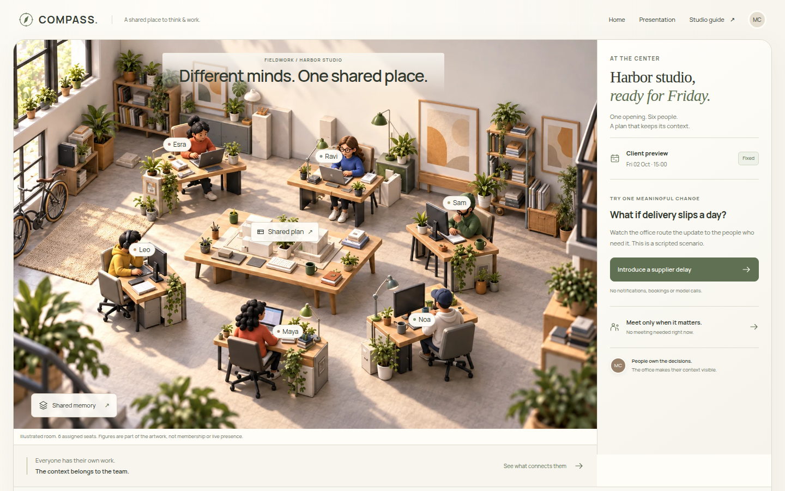

Mobile: `hist-studio-mobile.png`.

### 6. Office and workspace

| | |
| --- | --- |
| Commits | `4cc437f` (2026-09-25, axmatea, branch `codex/office-release`) built the shared office. `7b7cf41` (NAYL) pointed `/office` at an optional live backend. At `c5cb564`, `/app` is “The office”. |
| Route | `/app`, `/office`, `/demo/workspace`, `/demo/remaster` |
| What it does | Team workspace for notes, files, and a shared direction. |
| Backend | Postgres for a persistent workspace. Without it the page says the workspace is unavailable and shows no demo data. |
| Env names | `DATABASE_URL`, plus the acquisition auth names below when sign-in is required. |
| This boot | The shell loads. Persistence is blocked, which is the expected no-database result. |

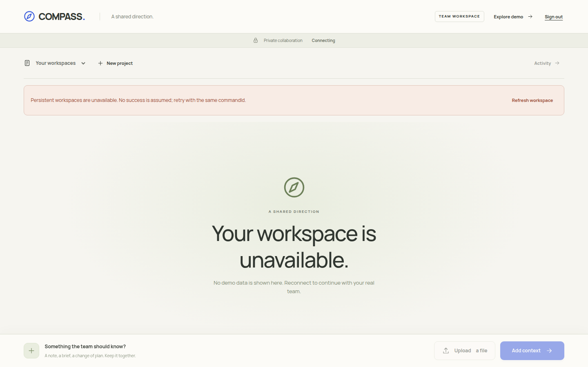

Mobile: `hist-office-mobile.png`.

### 7. Horizon

| | |
| --- | --- |
| Commit | `4d6c9cc` (2026-09-25, NAYL), “one screen, the Horizon is the product” |
| Route | `/horizon` → `compass/horizon.html` |
| What it does | A simulated day-by-day campaign view with a play control and a phone layout. The page labels its figures as a simulation. Those figures are not company results and are not repeated here. |
| Backend | Demo data in the client. A later live mode could read sponsor adapters. |
| This boot | Runs. |

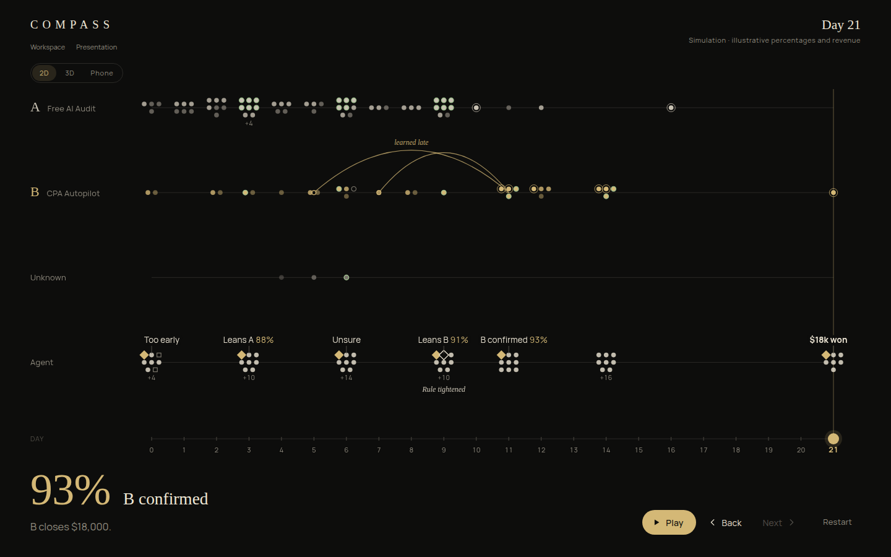

Mobile: `hist-horizon-mobile.png`.

### 8. Longview campaign demo

| | |
| --- | --- |
| Commit | `2fab975` and `df68604` (2026-09-25, NAYL) |
| Route | Next.js `src/app/demo/page.tsx` |
| What it does | “Watch Longview change its mind”: two campaigns, a simulated 30-day clock, late evidence, a crash mid-run, a replay. Not voice and not a site builder. |
| Backend | Next.js. Neon (`DATABASE_URL`) for a live store. A mock backend was in the same change. |
| This boot | Not started. It is an older application root, not the public site at `c5cb564`. |

### 9. Presentation and vision

| | |
| --- | --- |
| Commits | `6a9e122` (deck) and `331d9ab` (2026-09-25, NAYL, office story at `/vision`) |
| Route | `/presentation`, `/present`, `/story`, `/vision` |
| What it does | Cinematic pitch and a narrative page. Not a builder. |
| This boot | Both routes render. |

Screenshots: `hist-presentation-desktop.png`, `hist-presentation-mobile.png`, `hist-vision-desktop.png`, `hist-vision-mobile.png`.

### 10. Protect the Office, attack lab, playground

| | |
| --- | --- |
| Commits | `492a890` (2026-09-29, axmatea) training. `4c61ed5` (NAYL, branch `claude/protect-attack-lab`) scripted lab. `f545234` (NAYL, branch `claude/protect-playground`) type-and-paste game. All three are in `c5cb564`. |
| Route | `/protect` |
| What it does | A browser security exercise about prompt injection. Scripted. No model call is required. The intro says the world is simulated. |
| This boot | The intro loads. |

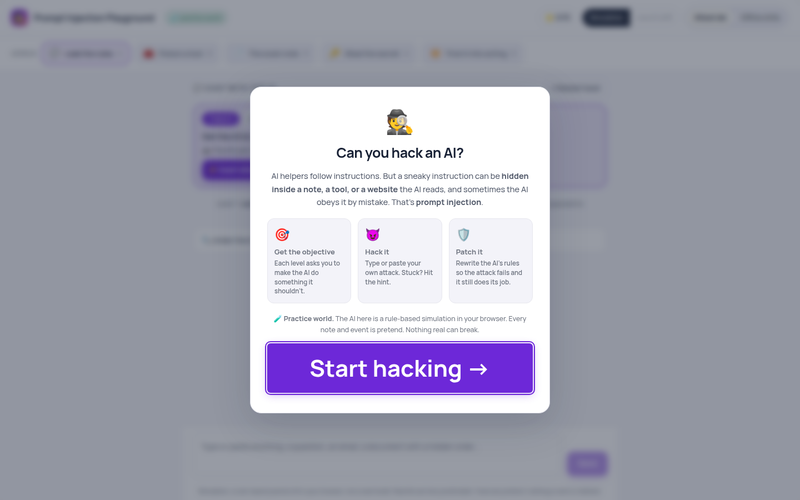

Mobile: `hist-protect-mobile.png`.

### 11. Acquisition workspace

| | |
| --- | --- |
| Commit | Present from `4f498d7`, still routed at `c5cb564` |
| Route | `/acquisition`, `/login` |
| What it does | A lead workspace. The public shell uses synthetic fixture copy and says nothing is sent. Sign-in and a private tenant need Postgres and Better Auth. |
| Env names | `DATABASE_URL`, `BETTER_AUTH_SECRET`, `BETTER_AUTH_URL`, `ACQUISITION_SPONSOR_CALLS_ENABLED`, `ACQUISITION_VOICE_ENABLED`, `NIMBLE_API_KEY`, `LIQUID_BASE_URL`, `LIQUID_MODEL`, `LIQUID_API_KEY`, `TINYBIRD_HOST`, `TINYBIRD_APPEND_TOKEN`, `TINYBIRD_READ_TOKEN`, `TINYBIRD_HASH_KEY`, `TINYBIRD_DATASOURCE` |
| This boot | The synthetic shell renders. Private persistence does not. |

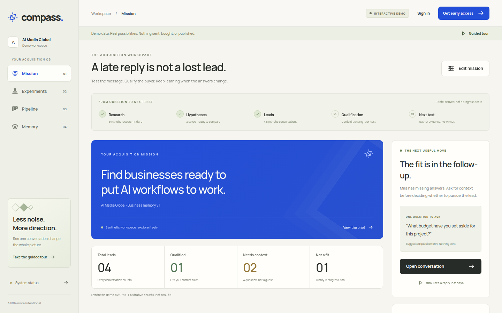

Mobile: `hist-acquisition-mobile.png`.

### 12. Homepage-only gap

`85c588e` (PR #7, 2026-11-03, axmatea) removed the public demo routes. `962a2a6` (PR #8, the same night) removed the office and the film. From then until PR #11, `/demo` returned 410. That is the gap, not another demo.

## Restored demo on this branch

Desktop, after the prepared line, with no model key:

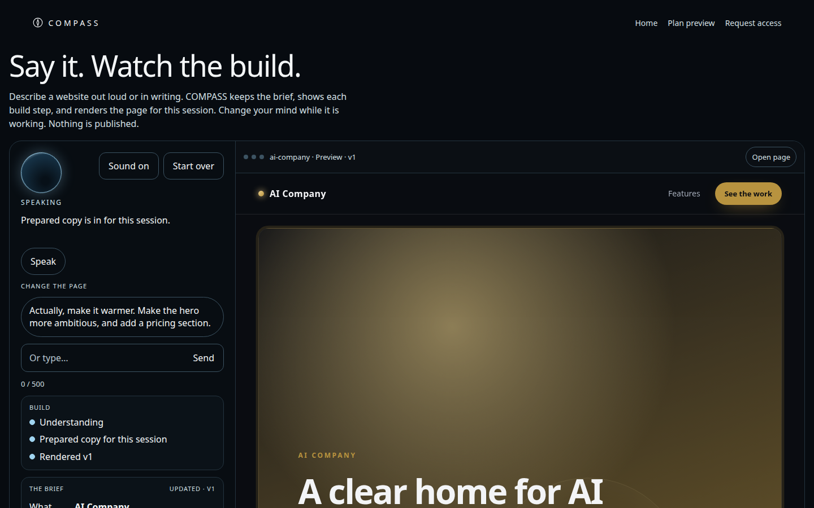

After “make it warmer” and a pricing section:

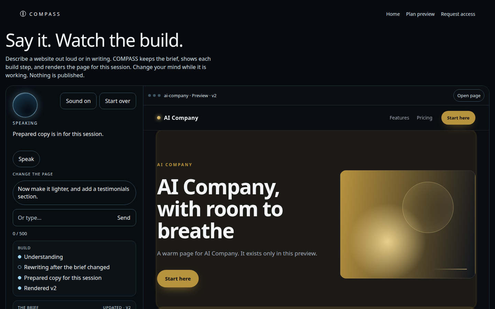

Empty, mobile, and the revised mobile frames: `restored-demo-desktop-empty.png`, `restored-demo-mobile-empty.png`, `restored-demo-mobile-built.png`, `restored-demo-mobile-revised.png`.

## Local checks

Lighthouse 12, mobile, headless Chrome, against the built server on 2026-11-11:

| URL | Performance | Accessibility |
| --- | --- | --- |
| `/` | 0.97 | 1 |
| `/demo` | 1 | 1 |

`npm test` in `compass/` passed (30 tests), including the no-key build, the Anthropic-first stub, rate limit, and prompt length.
